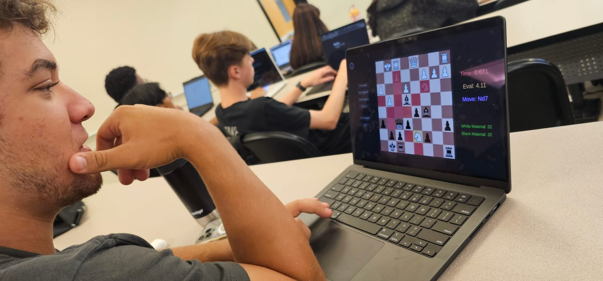

## Problem

TODO

## What I did

- Built a chess engine with minimax, alpha-beta pruning, quiescence search and positional evaluation.
- Integrated it into Unity.

## Result

TODO

## What I'd change

TODO
